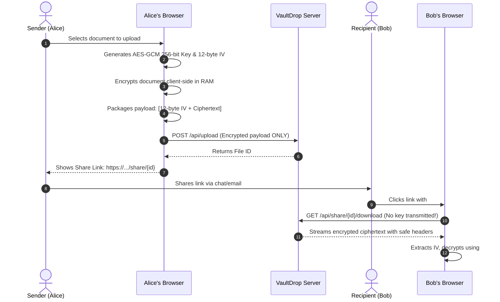

# 🔒 VaultDrop — Secure Document Vault & File-Sharing Service

> A production-ready, zero-knowledge, zero-dependency-headache full-stack web application built with **Node.js/Express**, **SQLite** (via `better-sqlite3`), and pure **Tailwind CSS** (via CDN) + **Vanilla JavaScript (Web Crypto API)** on the frontend. Ready for local execution and immediate 1-click deployment on **Render**.

---

## 🌟 Key Features

1. **Zero-Knowledge Client-Side Encryption (AES-GCM 256-bit)**:
   - Before any file leaves the browser, a 256-bit AES-GCM cryptographic key is generated client-side via the native **Web Crypto API** (`crypto.subtle`).
   - The file is encrypted in the browser's memory alongside a cryptographically secure 12-byte Initialization Vector (IV).
   - The encryption key is appended **strictly to the URL hash fragment** (`#key=<64-char-hex>`). Per RFC standards, hash fragments are never transmitted in HTTP requests, so the server never receives, logs, or stores your decryption keys.

2. **Malicious File Mitigation & Safe Downloads**:
   - Disallows executable and script file extensions (`.exe`, `.bat`, `.sh`, `.msi`, `.scr`, `.cmd`, `.vbs`, `.ps1`, `.com`, `.jar`, `.apk`, `.app`, `.dll`) on both frontend and backend.
   - Enforces strict security headers on all downloads:
     - `Content-Disposition: attachment; filename="vault_payload.bin"`
     - `X-Content-Type-Options: nosniff`
     - `Content-Type: application/octet-stream`
     - `Cache-Control: no-store, no-cache, must-revalidate, private`
   - Eliminates stored XSS, HTML injection, and MIME-sniffing execution vulnerabilities.

3. **Storage Quota & File Size Enforcement**:
   - **Per-file limit**: Strict 10MB maximum per file (enforced in browser and backend Multer pipeline).
   - **Per-user quota**: 50MB total storage quota per user, tracked in real-time in SQLite.
   - Visual progress bar with color-coded alerts (green ➔ amber ➔ red) and exact byte tracking.

4. **Configurable Expiration & Instant Revocation**:
   - Shareable links support customizable expiry: **1 hour**, **6 hours**, **24 hours**, or **7 days**.
   - If a link expires, the API immediately responds with **HTTP 410 Gone** and renders an explicit "Link Expired" warning card.
   - Owners can instantly toggle **Revoke / Restore** access with a single click. Revoked links immediately respond with **HTTP 403 Forbidden** and an explicit "Access Revoked" warning card.
   - Unknown or deleted files render a clear **HTTP 404** "File Not Found" card.
   - Missing hash key renders an informative "Missing Decryption Key" notice with manual key entry option.

5. **Real-Time Download Tracking & File Management**:
   - Atomic real-time download counter increments whenever an authorized user downloads the payload.
   - Full dashboard file list with search filter, expiry countdown timers, download badges, and 1-click share link copying.
   - Deleting a file unlinks it from the physical storage (`./uploads/`), purges the DB record, and instantly credits the freed storage space back to the user's quota.

---

## 🏗️ Architecture & Technology Stack

- **Backend**: Node.js & Express.js
- **Database**: SQLite via `better-sqlite3` (file-based database stored at `./data/vault.db`, automatically initialized on startup with WAL mode enabled)
- **File Storage**: Local persistent disk directory at `./uploads` via Multer
- **Authentication**: Cookie-based JWT (`httpOnly`, SameSite) with `bcryptjs` password hashing (cost factor 10)
- **Frontend**: Pure HTML5 + Vanilla JavaScript + Tailwind CSS (via CDN) with modern Dark Slate / Indigo UI aesthetic, Heroicons SVGs, and responsive design
- **Cryptography**: Native Browser Web Crypto API (`window.crypto.subtle`) using AES-GCM 256-bit with random 12-byte IV

---

## 📁 Repository File Structure

```text
vaultdrop/
├── data/                    # SQLite database directory (auto-created)
│   └── vault.db             # SQLite database file with WAL journal
├── middleware/
│   └── auth.js              # Cookie-based JWT authentication middleware
├── public/
│   ├── js/
│   │   └── crypto-helper.js # Browser-side Web Crypto AES-256-GCM encryption/decryption
│   ├── dashboard.html       # User dashboard: quota bar, upload dropzone, files table
│   ├── index.html           # Landing page + Sign In / Sign Up modal
│   └── share.html           # Public download page: client decryption & error states
├── uploads/                 # Encrypted blob storage directory (auto-created)
├── .env.example             # Environment variable template
├── .gitignore               # Git ignore rules for node_modules, uploads, DB
├── db.js                    # SQLite table initialization & WAL mode setup
├── package.json             # Node dependencies and execution scripts
├── render.yaml              # Render 1-click deployment Blueprint specification
├── server.js                # Express application entry point & API endpoints
├── test_suite.js            # Automated verification test suite (17/17 assertions)
└── README.md                # Comprehensive documentation
```

---

## 🚀 Local Quick Start

### Prerequisites
- Node.js v18+ (tested on Node v20)
- npm v9+

### 1. Installation
```bash
cd vaultdrop
npm install
```

### 2. Environment Configuration (Optional)
```bash
cp .env.example .env
```
Default parameters are automatically applied if `.env` is omitted:
- `PORT`: `3000`
- `NODE_ENV`: `development`
- `JWT_SECRET`: auto-configured fallback for local testing

### 3. Run the Automated Test Suite
```bash
npm test
```
Runs 17 automated assertions covering database initialization, password hashing, JWT cookies, quota tracking, overflow protection, download counter, expiry logic, revocation toggling, and file deletion.

### 4. Start the Application
```bash
npm start
```
Open your browser and navigate to:
```text
http://localhost:3000
```

---

## 🌐 Deploy to Render (1-Click Deployment)

VaultDrop includes a production-ready `render.yaml` blueprint.

### Method A: Deploy via Render Blueprint (Recommended)
1. Push this repository to GitHub or GitLab.
2. In the Render Dashboard, click **New +** and select **Blueprint**.
3. Select your repository. Render will automatically detect `render.yaml` and configure:
   - **Environment**: Node
   - **Build Command**: `npm install`
   - **Start Command**: `node server.js`
   - **Environment Variables**:
     - `NODE_ENV`: `production`
     - `PORT`: `10000`
     - `JWT_SECRET`: (automatically generated secure random key)
4. Click **Apply** to deploy.

### Method B: Manual Web Service Setup
1. Create a **New Web Service** pointing to your repository.
2. Set:
   - **Runtime**: `Node`
   - **Build Command**: `npm install`
   - **Start Command**: `node server.js`
3. Add Environment Variable:
   - `JWT_SECRET`: `<your-random-32-char-secret>`
   - `NODE_ENV`: `production`
4. Deploy!

*(Note: On Render's Free tier, the filesystem is ephemeral and resets on idle spin-down. For long-term persistent uploads and SQLite database across restarts, attach a Render Persistent Disk mounted to `/data` and `/uploads` if desired.)*

---

## 🔐 Zero-Knowledge Cryptography Details



1. **Key Generation**:
   `window.crypto.subtle.generateKey({ name: "AES-GCM", length: 256 }, true, ["encrypt", "decrypt"])`
2. **Payload Packing**:
   The generated 12-byte IV is prepended directly to the encrypted ciphertext:
   `[ 12-Byte IV ][ AES-GCM Ciphertext + Auth Tag ]`
   This makes the encrypted payload self-contained and verifiable.
3. **Key Exporting**:
   The 256-bit key is exported as raw bytes and converted into a 64-character URL-safe hexadecimal string appended after the URL `#` symbol.

---

## 🛡️ Security Verification

- **Executable File Blocking**: Files ending with `.exe`, `.bat`, `.sh`, `.msi`, `.cmd`, `.scr`, `.vbs`, `.ps1`, etc., are rejected by the frontend and hard-rejected with immediate unlinking on the backend.
- **Header Hardening**:
  - `X-Content-Type-Options: nosniff`
  - `X-Frame-Options: DENY`
  - `Referrer-Policy: strict-origin-when-cross-origin`
- **Cookies**: Authentication tokens are stored in `httpOnly`, `SameSite: lax` cookies with `secure: true` in production environments.

---

## 📄 License
MIT License. Free for commercial and non-commercial use.
